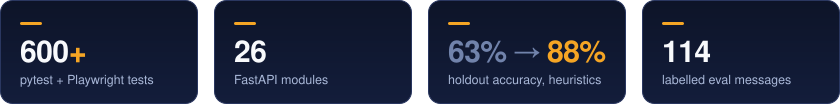

  
  
  

## Hi, I'm Saleet

I'm a Computer Science and Engineering undergraduate at the **University of Kashmir** (B.Tech, class of 2029) who builds full-stack products end to end: Python and FastAPI on the back, TypeScript and Next.js on the front, PostgreSQL underneath.

Lately most of my time goes into AI features that hold up outside a demo. That means evaluation sets with held-out data, a fallback path for when the model is unavailable, and tests around everything.

## Featured work

### DataShelf — AI customer inbox and CRM for small businesses

`Python` `FastAPI` `PostgreSQL` `Next.js 16` `TypeScript` `Claude API`

- **One inbox for every channel.** Gmail and Instagram through official OAuth, plus WhatsApp and CSV imports, land in a single triaged inbox and unified CRM.
- **An analysis pipeline, not a prompt.** Each message is classified by category, intent and sentiment, scored as a lead from 0 to 100 across four weighted components, and given a drafted reply. It runs on the Claude API with a rule-based fallback that also reads Hinglish.
- **Measured, then improved.** I built an evaluation harness of 114 labelled messages with dev, holdout and fresh splits, raised heuristic holdout accuracy from 63% to 88%, and used the unseen split to catch overfitting.
- **A real back office.** 26 API modules cover CRM, invoices, quotes, expenses and profit reports on async SQLAlchemy and Alembic.
- **Secured and verified.** bcrypt, JWT auth, encrypted OAuth tokens and role-based access, checked by 600+ pytest tests and Playwright end-to-end runs.

### Internship Portal — applications, resume builder and skill matching

`Java` `JSP` `Servlets` `JDBC` `MySQL`

- **Two-sided platform.** Applicants create profiles and apply; recruiters post openings and shortlist candidates.
- **Resume builder.** Turns an applicant's profile data into a clean, shareable resume.
- **Skill matching.** Scores each applicant against the recruiter's requirements and ranks candidates on a dashboard, which cuts manual screening.

## Toolbox

<table>
  <tr><th align="left">Languages</th><td></td></tr>
  <tr><th align="left">Backend</th><td> &nbsp; SQLAlchemy · Pydantic · REST · OAuth 2.0</td></tr>
  <tr><th align="left">Frontend</th><td></td></tr>
  <tr><th align="left">Databases</th><td> &nbsp; Alembic migrations</td></tr>
  <tr><th align="left">AI and data</th><td> &nbsp; Claude API · prompt design · model evaluation · NumPy · pandas</td></tr>
  <tr><th align="left">Testing and tools</th><td> &nbsp; pytest · Playwright</td></tr>
  <tr><th align="left">Security</th><td>JWT · bcrypt · encryption at rest · role-based access control</td></tr>
  <tr><th align="left">Also trained in</th><td></td></tr>
</table>

## How I work

- **I test what I ship.** If a feature matters, it has a test that fails when it breaks.
- **I measure AI instead of trusting it.** Labelled data, a held-out split, and a number that has to go up.
- **I plan for failure.** Fallbacks for when an API is down, encryption for anything sensitive, roles for anything shared.

## Education

- **B.Tech, Computer Science and Engineering** — University of Kashmir, Srinagar (expected 2029)
- **Graduation in Information Technology** — ILS Srinagar

Based in Srinagar, working with teams anywhere. The fastest way to reach me is <a href="https://www.linkedin.com/in/mohammad-saleet-dar-054a83367">LinkedIn</a> or <a href="mailto:mohammedsaleetdar@gmail.com">email</a>.

